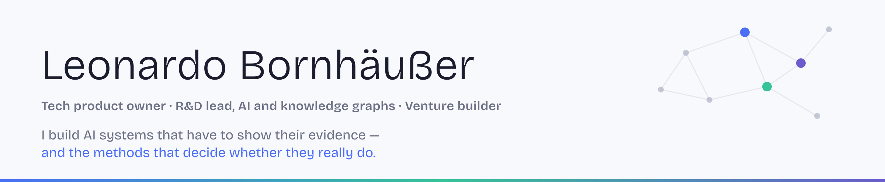
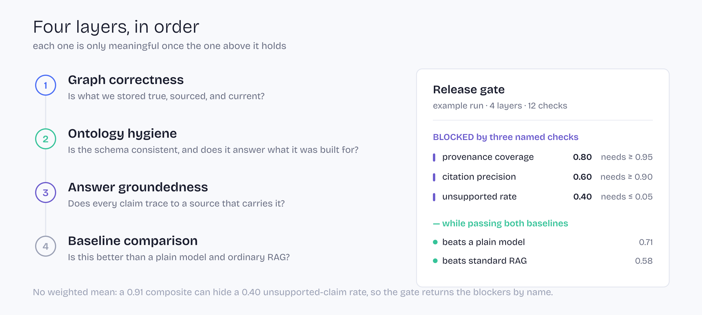
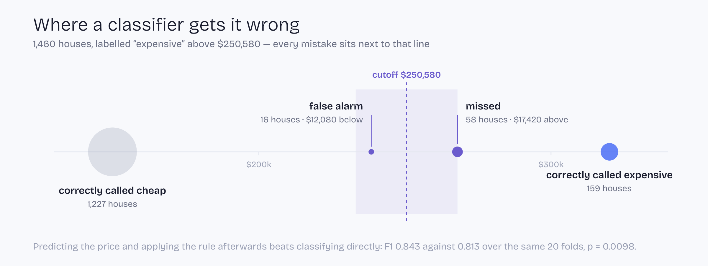

<picture>
  <source media="(prefers-color-scheme: dark)" srcset="assets/banner-dark.png">
  
</picture>

I consult on AI projects, build the systems, and ship my own products where the
case holds up. Managing director and CTO at
[Creativate Technologies](https://creativate.tech) in Frankfurt, where the work
is knowledge-graph grounding, provenance and audit trails — mostly for finance,
legal and public-sector users who cannot accept "the model said so".

Most of that work is under NDA or not released yet. What is here is the part
that can be shown, and a theme runs through it: the headline number is usually
the one to distrust, and most of the effort goes into finding out whether it
means anything.

---

## Research

**[grounded-ai-evals](https://github.com/adminleo/grounded-ai-evals)**
&nbsp;

How do you test a system whose job is to answer *with evidence*? Four layers —
graph correctness, ontology hygiene, answer groundedness, baseline comparison —
ordered so that each one is only meaningful once the one above it holds. The
library computes the metrics and renders a release gate that blocks on named
checks rather than on a weighted mean.

<picture>
  <source media="(prefers-color-scheme: dark)" srcset="assets/eval-gate-dark.png">
  
</picture>

The example run above is the argument for the design: a system that beats a
plain model and ordinary RAG, and is still blocked, by name, on provenance
coverage, citation precision and unsupported-claim rate. An average would have
let it through. Standard library, tested, with the method mapped to public
standards and to the EU AI Act articles the evidence serves.

Also public: **[governed-graph-growth](https://github.com/CreativateLabs/governed-graph-growth)**
&nbsp;
— a technical note on letting a knowledge graph grow without letting it rot.
Next: evaluation methods for AI that answers with evidence, and point-in-time
legal grounding. Papers in preparation; artefacts land here first.

---

## Building and running things

| | |
|---|---|
| **Creativate Technologies** | Founded January 2024. Grew it into a consultancy with productive software, then carried the R&D into deep tech — knowledge graph, provenance, the c:node product line. Managing director and CTO. |
| **Camsol** | 2022 – 2024, exited at the end of 2024. |
| **Shipped** | At least seven products taken all the way into operation, from lead generation to regulated-document assistants — among them [c:node](https://c-node.ai), AI Playbook and LeadScout. |
| **Scale** | Teams of up to around a hundred people. Roughly €2.5M in research funding won and delivered. Over a million lines of code since January 2026 in projects I was responsible for, built agentically. |

What that adds up to day to day: owning a product line end to end — discovery,
architecture, the roadmap, the release gate — and being the person who has to
say *this is not ready* when the demo looks fine.

---

## Selected repositories

### Systems and pipelines

**[gans-data-pipeline](https://github.com/adminleo/gans-data-pipeline)**
&nbsp;

Scrapes city facts, weather and arriving flights into SQL on a daily schedule —
local first, then the same function on Cloud Functions behind Cloud SQL, with a
[live page](https://adminleo.github.io/gans-data-pipeline/) that reads a
published snapshot so the database keeps no public route. The population column
turned out to be the interesting part: Wikipedia uses six different labels for
it across seven cities and dates them from a 2006 census to 2026, so a hardcoded
label returns nothing for four of them — silently, as a missing value.

### Models, and the metrics that mislead

**[ames-house-prices](https://github.com/adminleo/ames-house-prices)**
&nbsp;

Is this house expensive, and what is it worth? Answering "no" to every house is
right 85.1 % of the time and finds none of them, so the work is in the metrics
that survive a 14.9 % positive rate.

<picture>
  <source media="(prefers-color-scheme: dark)" srcset="assets/ames-errors-dark.png">
  
</picture>

Every mistake sits next to the cutoff that *defined* the label — so predicting
the price and applying the rule afterwards beats classifying directly, F1 0.843
against 0.813 over the same 20 folds (p = 0.0098). Also: grid search scored on
its own folds inflates F1 by 0.027 for a tree and 0.000 for a linear model.

**[moosic-playlists](https://github.com/adminleo/moosic-playlists)**
&nbsp;

Can K-Means turn Spotify audio features into playlists? The features carry real
similarity — a song's nearest neighbours share its artist 19.5× more often than
chance — but the clusters describe how a track was *recorded*, not how it feels:
of 92 titles recorded by two different artists, only 23.9 % land together.
Forget to scale and the eight clusters come out as a ladder of track length,
2.6 to 61.7 minutes, with no error raised.

### Analysis that ends in a decision

**[eniac-magist-analysis](https://github.com/adminleo/eniac-magist-analysis)**
&nbsp;

Should a European retailer enter Brazil through a logistics partner? 99,441
marketplace orders, ending in a recommendation that contradicts the deal on the
table. Every figure traces to the query that produced it, and the repository is
explicit about the one question the data cannot answer.

**[eniac-discount-strategy](https://github.com/adminleo/eniac-discount-strategy)**
&nbsp;

Cleaning a corrupted retail dataset, where the interesting question is which
corruptions can be repaired and which cannot. Three columns look repairable and
are not — and proving it moves a headline number by a factor of ten. A blanket
divisor reproduced the undamaged rows' ratio to the price paid almost exactly
while listing a MacBook Pro at €35,255.

### Foundations

**[sql-foundations](https://github.com/adminleo/sql-foundations)** — eighty-nine
queries from `SELECT` to chained joins, each executed against the database by a
verifier rather than only written. ·
**[ab-testing](https://github.com/adminleo/ab-testing)** — a sample-size
calculator and a design checklist, existing mostly to make one relationship
obvious: halving the effect you want to detect quadruples the traffic you need.

---

## How I work

**Set the threshold before the run.** A bar agreed afterwards is a description,
not a test. `Check` takes the measured value and the bar in the same call so a
scorecard cannot be assembled to flatter the result, and an unmeasured check
fails closed. — [grounded-ai-evals](https://github.com/adminleo/grounded-ai-evals)

**Ask what the metric is actually measuring.** Clusters that look like genres
and turn out to be recording conditions; an F1 that moves because the label was
drawn with a ruler. Both only showed up once the evaluation was aimed at the
claim instead of the model. —
[moosic-playlists](https://github.com/adminleo/moosic-playlists),
[ames-house-prices](https://github.com/adminleo/ames-house-prices)

**Say which question the data cannot answer.** Writing that line down is
usually the most useful paragraph in a report, and the one most often left out.
— [eniac-magist-analysis](https://github.com/adminleo/eniac-magist-analysis)

**Prefer a loud failure to a quiet one.** A hardcoded label that returns nothing
costs more than a crash, because nobody goes looking. Every fallback in these
repositories reports what it did not recognise. —
[gans-data-pipeline](https://github.com/adminleo/gans-data-pipeline)

---

## Working with

Eight, not eighty — the ones I would be happy to be tested on. Alongside them:
Next.js in production, Postgres and SQLite, graph stores, and a long-standing
preference for systems that can show their work.

Activity

<picture>
  <source media="(prefers-color-scheme: dark)" srcset="https://github-profile-summary-cards.vercel.app/api/cards/profile-details?username=adminleo&theme=github_dark">
  
</picture>

[CV](https://adminleo.github.io/cv/) ·
[creativate.tech](https://creativate.tech) ·
[LinkedIn](https://www.linkedin.com/in/leonardo-bornhaeusser) ·
[ORCID](https://orcid.org/0009-0005-6464-5179)
