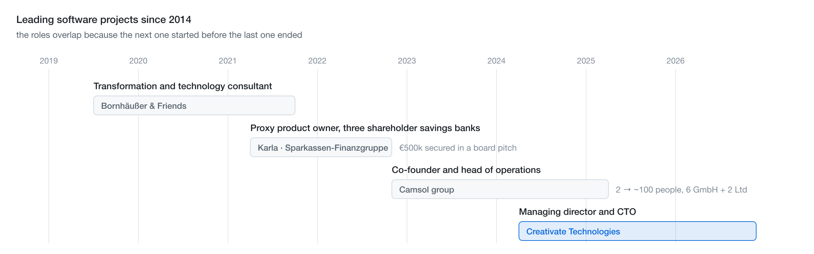
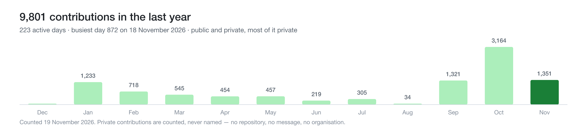

<picture>
  <source media="(prefers-color-scheme: dark)" srcset="assets/career-dark.png">
  
</picture>

I consult on AI projects, build the systems, and ship my own products when the
case holds up.

I am managing director and CTO at
[Creativate Technologies](https://creativate.tech) in Frankfurt. We build AI
that has to prove its answers: every statement points back to a source, and the
trail can be checked afterwards. Our users work in finance, law and the public
sector, where "the model said so" is not an acceptable answer.

Most of that work is under an NDA or not released yet. This page shows the part
that can be shown. One idea runs through all of it: the headline number is
usually the one to distrust, and most of the work goes into finding out whether
it means anything.

---

## Products and platforms I have owned

| | |
|---|---|
| **[c:node](https://c-node.ai)** · 2024 – now founder, architect, lead | Software that answers questions from a company's own knowledge and shows where each answer comes from. Built from scratch. In 2026 I replaced the original single program (~258,000 lines) with separate services, each with one job, plus its own login and billing. Runs in the cloud or entirely on a customer's own servers. Live: [c-node.ai](https://c-node.ai) · [try.c-node.ai](https://try.c-node.ai) · [graph.c-node.ai](https://graph.c-node.ai) |
| **[Zulano](https://www.zulano.io)** · 2026 – now architecture and ontology | An assistant for public-sector applications and funding research. Behind it sit 34 million structured records as source material, and a Java service that decides which authority is responsible using fixed rules. That decision must not depend on a model's guess, so it does not. Live: [zulano.io](https://www.zulano.io) · [app.zulano.io](https://app.zulano.io) |
| **LeadScout · Claudio · [AI&nbsp;Playbook](https://ai-playbook.creativate.tech)** · 2025 – 2026 founder, lead | Three products taken to paying customers: a lead engine for B2B sales with scoring and CRM connections, an assistant that turns a voice note into a task (web app and signed desktop app), and an AI readiness check in three languages that writes its own PDF report and sells in two tiers. I owned positioning, pricing, and what the service does and does not promise. In 2026 I folded all three into c:node; [AI Playbook](https://ai-playbook.creativate.tech) is still up. |
| **[Gasvisor](https://gasvisor.eu)** · 2022 – 2024 product lead | CO₂ monitoring for industrial sites. Battery sensors measure fill level, temperature and humidity and send it over the mobile network. A dashboard predicts consumption and reorders automatically. Built around German safety rules (TRGS 510) and ESG reporting, and taken from a first version to enterprise customers. |
| **[CheckMe](https://checkme-app.com/en)** · 2023 – 2025 product lead | Breast cancer early detection for women in sub-Saharan Africa, where specialists are far away. Mobile apps and web, an AI companion, and ultrasound analysis that produces a BI-RADS report for a radiologist to review. Clinical and regulatory stakeholders, privacy built in from the start. |
| **Karla** · 2021 – 2022 proxy product owner | A platform of the German savings banks group for services beyond banking. I ran a headless CMS and a multi-vendor shop, connected to the group's Java systems. Three savings banks held shares and each had its own requirements; I turned them into one backlog and prepared the committee decisions. A joint pitch to the board secured €500,000. |

Before that: first technical lead in 2014, and a decade of software projects
since. The full account is in the [CV](https://adminleo.github.io/cv/).

---

## Where it actually runs

I deploy and then operate. The thing that breaks on a Sunday is mine.

- **AWS** — EC2 with Docker behind Caddy and automatic TLS, S3 and CloudFront,
  Lambda, ECR with lifecycle rules, Route 53, security groups opened and closed
  per session. Day to day over the CLI, not the console.
- **Google Cloud** — Cloud Functions on a schedule, talking to Cloud SQL over a
  unix socket, secrets in Secret Manager, Cloud Scheduler authenticating with
  OIDC. The public receipt is
  [gans-data-pipeline](https://github.com/adminleo/gans-data-pipeline), deploy
  and teardown scripts included.
- **Hetzner** — smaller services and staging, where the cost per gigabyte of RAM
  decides it.
- **On-premise and air-gapped** — one command installs the whole stack on a
  customer's own hardware, with the model running locally on their GPU. For
  buyers whose data cannot leave the building. One pilot ran on a German city's
  live data.

What I have not done, in case it saves someone a call: no managed Kubernetes in
production, and no Bedrock.

---

## Research

**[grounded-ai-evals](https://github.com/adminleo/grounded-ai-evals)**
&nbsp;

How do you test a system whose job is to answer *with evidence*? In four layers,
in a fixed order, because each layer only tells you something once the one above
it holds. The library measures all of it and produces a release gate: instead of
averaging everything into one score, it names the checks that failed.

<picture>
  <source media="(prefers-color-scheme: dark)" srcset="assets/eval-gate-dark.png">
  
</picture>

The example shows why that matters. The system beats a plain model and ordinary
RAG, and it is still blocked — by name, on three checks. An average would have
waved it through. Standard library, tested, and the method is mapped to public
standards and to the EU AI Act articles the evidence serves.

Also public:
**[governed-graph-growth](https://github.com/CreativateLabs/governed-graph-growth)**
&nbsp;
— a short note on how to let a knowledge graph grow without letting it rot.
Next up: how to evaluate AI that answers with evidence, and how to ground an
answer in the law as it stood on a given day. Papers in preparation; the
artefacts land here first.

---

## Public code

### Pipelines

**[gans-data-pipeline](https://github.com/adminleo/gans-data-pipeline)**
&nbsp;

Collects city facts, weather and arriving flights into a SQL database once a
day. First on a laptop, then the same code on Google Cloud. A
[live page](https://adminleo.github.io/gans-data-pipeline/) reads a published
snapshot, so the database itself needs no public route.

The interesting part was the population figure. Wikipedia labels it in six
different ways across seven cities, and dates it anywhere from a 2006 census to
2026. Look for one fixed label and four of the seven return nothing — quietly,
as a missing value.

### Models, and the metrics that mislead

**[ames-house-prices](https://github.com/adminleo/ames-house-prices)**
&nbsp;

Is this house expensive, and what is it worth? Saying "no" to every house is
right 85.1 % of the time and finds none of them, so the work is in choosing
metrics that survive that.

<picture>
  <source media="(prefers-color-scheme: dark)" srcset="assets/ames-errors-dark.png">
  
</picture>

Every mistake sits right next to the price line that defines the label. So it
works better to predict the price first and apply the rule afterwards than to
classify directly: F1 0.843 against 0.813 over the same 20 folds, p = 0.0098.
One more: tuning a model and scoring it on the same folds makes a decision tree
look 0.027 better than it is, and a linear model not at all.

**[moosic-playlists](https://github.com/adminleo/moosic-playlists)**
&nbsp;

Can K-Means turn Spotify audio features into playlists? The features do carry
real similarity: a song's nearest neighbours share its artist 19.5 times more
often than chance. But the clusters describe how a track was recorded, not how
it sounds to a listener — of 92 titles recorded by two different artists, only
23.9 % end up in the same cluster. Forget to scale the data and the eight
clusters simply sort songs by length, 2.6 to 61.7 minutes, without raising an
error.

### Analysis that ends in a decision

**[eniac-magist-analysis](https://github.com/adminleo/eniac-magist-analysis)**
&nbsp;

Should a European retailer enter Brazil through a logistics partner? 99,441
orders, and an answer that contradicts the deal on the table. Every number links
back to the query that produced it, and the repository says plainly which
question the data cannot answer.

**[magist-ask](https://github.com/adminleo/magist-ask)**
&nbsp;

The same 99,441 orders, but you ask the questions. A model writes the SQL and
**the SQL is shown next to the answer**, because a number on its own asks to be
believed and a number with its query can be argued with. Letting a model write
SQL against a database is an injection surface with better manners, so only
`SELECT` and `WITH` get through, no write verb may appear anywhere in the body,
and the connection underneath is read-only in case that guard is wrong.

**[eniac-discount-strategy](https://github.com/adminleo/eniac-discount-strategy)**
&nbsp;

Cleaning a broken retail dataset. The real question is which damage can be
repaired and which cannot. Three columns look repairable and are not, and
proving that moves a headline number by a factor of ten. Dividing every price by
ten matched the undamaged rows almost perfectly — and priced a MacBook Pro at
€35,255.

### Foundations

**[sql-foundations](https://github.com/adminleo/sql-foundations)** — eighty-nine
queries from `SELECT` to chained joins, each one actually run against the
database by a verifier rather than only written down. ·
**[ab-testing](https://github.com/adminleo/ab-testing)** — a sample-size
calculator and a design checklist, mostly to make one thing obvious: halve the
effect you want to detect and you need four times the traffic.

---

## How I work

### Running the work

**Scrum or Kanban, whichever the team can actually sustain.** Planning, review
and retrospective, with refinement happening *before* planning rather than
inside it. Most teams that say sprints do not work are refining in the planning
meeting.

**The ticket is the specification.** It carries the acceptance criteria, and
work is done when the criteria are met, not when the code exists. Everything
downstream — review, tests, the release decision — reads that one document.

**Decisions get written down.** Architecture decision records, with the option
that was rejected and the reason. A team's memory is what survives the people
who were in the room.

**OKRs for direction, a handful of KPIs for whether it is working.** I have run
this with international, multilingual teams across several time zones, where
the written-down version is the only version that exists.

**One confirmation gate before anything irreversible.** Deploys, deletions,
anything customer-facing. The gate is a person, and it is not negotiable
because the pipeline is green.

### Judging the result

**Agree the bar before the run.** A threshold set afterwards describes a result,
it does not test it. In grounded-ai-evals the measured value and the bar go into
the same call, so no scorecard can be assembled later to flatter the outcome. A
check that was never measured counts as failed. —
[grounded-ai-evals](https://github.com/adminleo/grounded-ai-evals)

**Ask what a metric is really measuring.** Clusters that looked like genres
turned out to be recording conditions. An F1 score moved because the label had
been drawn with a ruler. Both only showed up once I tested the claim instead of
the model. — [moosic-playlists](https://github.com/adminleo/moosic-playlists),
[ames-house-prices](https://github.com/adminleo/ames-house-prices)

**Write down the question the data cannot answer.** It is usually the most
useful sentence in a report, and the one most often missing. —
[eniac-magist-analysis](https://github.com/adminleo/eniac-magist-analysis)

**A loud failure beats a quiet one.** A fixed label that silently returns
nothing costs more than a crash, because nobody goes looking. Every fallback in
these repositories reports what it did not recognise. —
[gans-data-pipeline](https://github.com/adminleo/gans-data-pipeline)

---

## Working with

Eight, not eighty — the ones I would be happy to be tested on. Alongside them:
pandas and scikit-learn, Postgres and SQLite, graph stores, Java and Spring Boot
at architecture level, Ollama for local inference, and a long-standing
preference for systems that can show their work.

---

## Activity

<picture>
  <source media="(prefers-color-scheme: dark)" srcset="assets/contributions-dark.png">
  
</picture>

Redrawn every day by
[a workflow in this repository](.github/workflows/contributions.yml), because a
third-party card cannot see private contributions — the API hands those to the
account that made them and to nobody else. Most of the work above is private,
so a card would have shown a flat line.

---

## Talk to me

If any of this is close to a problem you have:
**[book 30 minutes](https://calendar.app.google/wKQLGVxpP1n67fZL6)**. No deck,
no discovery questionnaire — bring the problem and we will see whether I am the
right person for it.

[CV](https://adminleo.github.io/cv/) ·
[creativate.tech](https://creativate.tech) ·
[c-node.ai](https://c-node.ai) ·
[LinkedIn](https://www.linkedin.com/in/leonardo-bornhaeusser) ·
[ORCID](https://orcid.org/0009-0005-6464-5179)
